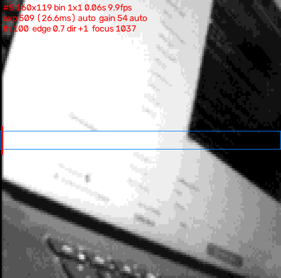
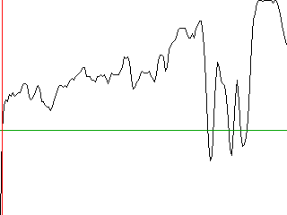

# esp32c3-ov7670-smart-light-curtain

**Günstige intelligente Lichtschranke:** ein OV7670-Kameramodul (ohne FIFO) an einem
ESP32-C3 SuperMini als **4-Bit-Zeilenkamera**. Statt „Strahl unterbrochen ja/nein“ liefert sie
entlang eines schmalen Spalts die **Position der ersten Hell/Dunkel-Kante als Zahl**, zum
Beispiel die Höhe eines vorbeifahrenden Röhrchens. Fachlich ist das ein kamerabasierter
**Mess-Lichtvorhang** (engl. *measuring light curtain*).

- Bis zu **37 Messungen/s**, Auflösung 160 Positionen entlang des Spalts (QQVGA)
- Die schmale Seite des Spalts (bis 8 Pixel) wird gemittelt. Das senkt das Rauschen und ergibt
  feinere Stufen als 4 Bit; die Kantenposition wird mit Nachkommastelle interpoliert.
- Belichtung und Verstärkung fest einstellbar, Schwellenwert, Kantenrichtung wählbar
- Auswertung komplett auf dem ESP32-C3; über USB kommt nur eine Textzeile pro Messung
- Live-Bild 160×119 als Einstellhilfe für Fokus, Belichtung, Verstärkung und Schwelle
- Hardware für wenige Euro: Kameramodul + ESP32-C3 SuperMini, keine Zusatzbauteile außer
  ggf. zwei I2C-Pull-ups

## Einstellen: Live-Bild



`viewer.py` zeigt das 160×119-Bild mit eingezeichnetem Spalt. Die rote Marke ist die Kante,
die die Messung mit dem aktuellen Schwellenwert finden würde. Der Fokuswert (Varianz des
Laplace-Filters im Spalt-Umfeld) wird beim Scharfstellen am Objektiv maximal.

## Messen



```
$ python3 scan.py /dev/ttyACM0 --roi 0 56 160 8 --th 100 --plot
MODE 2 160 119
SCAN row 0..159 bin 1x8
 3427715 ms  pos    1.4  dir  1   (17.6/s)
 3427742 ms  pos    1.1  dir  1   (18.5/s)
 3427769 ms  pos    1.1  dir  1   (19.4/s)
 3427795 ms  pos    1.0  dir  1   (20.3/s)
```

`pos` ist die Kantenposition in Pixeln entlang des Spalts (-1 = keine Kante), `dir` +1 für
dunkel→hell, −1 für hell→dunkel. Die Zeitstempel der Firmware zeigen den Abstand von 27 ms
(~37/s); die Rate in Klammern ist ein Mittel seit Programmstart und steigt in den ersten
Sekunden erst an.

## Hardware

| OV7670-Modul | ESP32-C3 SuperMini | Hinweis |
|---|---|---|
| 3V3 / GND | 3V3 / GND | |
| RESET | 3V3 | |
| PWDN | GND | |
| SIOC | GPIO9 | 4k7 nach 3V3, falls nicht auf dem Modul |
| SIOD | GPIO8 | 4k7 nach 3V3, falls nicht auf dem Modul |
| XCLK | GPIO0 | 10 MHz vom ESP (LEDC) |
| PCLK | GPIO1 | |
| VSYNC | GPIO3 | |
| HREF | GPIO10 | |
| D4, D5, D6, D7 | GPIO4, 5, 6, 7 | nur das obere Nibble wird gelesen |
| D0–D3 | – | offen lassen |

**Montage:** Am besten die Kamera so drehen, dass die zu messende Richtung (z. B. Röhrchenhöhe)
entlang einer Sensorzeile liegt, und den Spalt nahe an den Bildanfang legen. Die Rate bleibt
gleich, das Ergebnis ist dann aber früher im Bild fertig.

## Installation

Firmware (Arduino-Core esp32 ≥ 3.x, Board „ESP32C3 Dev Module“, **USB CDC On Boot: Enabled**):

```
arduino-cli compile -u -p /dev/ttyACM0 -b esp32:esp32:esp32c3:CDCOnBoot=cdc ov7670_c3
```

Host-Skripte (Python 3):

```
pip install -r requirements.txt
```

## Bedienung

### viewer.py: Einstellhilfe

```
python3 viewer.py /dev/ttyACM0 --slit 0 56 160 8 --th 100
```

| Taste | Funktion |
|---|---|
| e / r | Belichtung kürzer / länger (schaltet beide Automatiken ab) |
| g / f | Verstärkung kleiner / größer (schaltet beide Automatiken ab) |
| x | Belichtung und Verstärkung zurück auf Automatik |
| t | Pixel ≥ Schwellenwert grün einfärben |
| + / - | Schwellenwert ändern (Schritt 5) |
| a | Dauerbetrieb an/aus |
| Leertaste | Einzelbild |
| s | Bild als PNG speichern |
| q / Esc | beenden; gibt die passenden `scan.py`-Parameter aus |

Wichtige Optionen: `--slit X Y W H` (wie `scan.py --roi`), `--th`, `--exp`, `--gain`,
`--fps` (Standard 3), `--shot DATEI` (Fensterbild speichern und beenden).
Alle Optionen: `python3 viewer.py -h`.

### scan.py: Messung

```
python3 scan.py /dev/ttyACM0 --roi X Y W H --th TH [--pol 0|1|2] [--exp N] [--gain N] [--plot]
```

- `--roi`: Spalt in Pixeln (QQVGA: 160×119). Die schmale Seite (≤ 8) wird gemittelt, die lange
  ist die Messrichtung. Waagrechter und senkrechter Spalt sind gleich schnell.
- `--th`: Schwellenwert 0..255 (Grauwert × 17, wie im Live-Bild)
- `--pol`: 0 beide Kanten, 1 nur dunkel→hell, 2 nur hell→dunkel
- `--plot`: Profil, Schwelle und Kante live anzeigen (zum Einstellen von `--th`)

Die Messung läuft auch ohne PC-Skript: Jedes Terminal mit `S …` (siehe unten) liefert die
`EDGE`-Zeilen; ein beliebiges Zeichen beendet sie.

## Serielles Protokoll

USB-CDC, Textzeilen, Werte dezimal (Register hexadezimal).

| Befehl | Antwort | Bedeutung |
|---|---|---|
| `S x y w h th [pol [prof]]` | `SCAN …`, dann je Bild `EDGE pos dir ms` | Spaltmessung, bis ein Zeichen ankommt; `prof 1` zusätzlich `PROF` (Profil hex) |
| `E [n]` | `EXP lines µs auto` | Belichtung in Zeilenperioden, 0 = Automatik |
| `G [n]` | `GAIN raw auto` | Verstärkung 0..1023, −1 = Automatik |
| `M [n]` | `MODE n w h` | Bildmodus: 2 = QQVGA 160×119 (Standard für die Messung), 1 = QVGA, 0 = VGA |
| `C x y w h s p bh bv` | `IMG ow oh sum16 bpp` + Daten + `END` | Bild/Ausschnitt, für den Viewer |
| `I` | `ID 76 73` | Sensor-ID |
| `R rr` / `W rr vv` | `REG rr vv` / `OK` | Sensorregister lesen/schreiben |
| `T` | `TIM period_us vsync_us lines` | Bildtakt messen |
| `P` | `PINS …` | Flanken je Kamera-Pin zählen (Verdrahtungstest) |

Ein Moduswechsel (`M`) setzt den Sensor zurück, danach gelten wieder die Automatiken.
Ausführliche Beschreibung im Kopf von [`ov7670_c3/ov7670_c3.ino`](ov7670_c3/ov7670_c3.ino).

## Technische Hinweise und Grenzen

- **Kein Kamera-Interface:** Der ESP32-C3 hat keins. Die Pixel werden per Polling über
  *Dedicated GPIO* gelesen (CPU-Register, 1 Takt). Das schafft einen Pixeltakt bis 7,5 MHz;
  10 MHz geht nicht mehr. Über `GPIO_IN_REG` war schon bei 5 MHz in ~20 % der Zeilen das
  erste Byte verloren.
- **Rate = Bildrate:** Jede Sensorzeile kommt nur einmal pro Bild, daher eine Messung pro Bild,
  egal wie klein der Spalt ist. Sensor-Windowing (VSTRT/VSTOP) verkürzt das Bild beim OV7670
  **nicht** (gemessen). Schneller wird es nur über einen höheren internen Takt mit DCW-
  Unterabtastung (QQVGA: PLL ×6, PCLK/4 → 27 ms pro Bild).
- **4 Bit:** Nur D7..D4 sind angeschlossen. Feinere Stufen entstehen durch das Mitteln
  über die Spaltbreite.
- **USB-Eigenheit:** Das letzte USB-Paket einer Übertragung bleibt im ESP32-C3 gelegentlich
  hängen, bis weitere Daten folgen. Firmware und Viewer schieben es mit einem `END` bzw. einer
  kurzen Nachfrage hinterher; Bilder sind zusätzlich per Prüfsumme gesichert.
- **Sensor:** Getestet mit einem Modul, das sich als OV7670 meldet (PID/VER 0x76/0x73).

## Status

Funktionsmuster, auf einem Aufbau getestet. Eine Lizenz ist noch nicht festgelegt.

---

*README erstellt 2026-11-18 mit Claude Code auf Wunsch des Autors: „Bitte bei github ein Projekt
anlegen und puschen mit readme und wenns geht mit hilfe und screenshots. Idee ist: günstige
intelligente Lichtschranke“. Messwerte stammen aus Tests am Aufbau vom 2026-11-17/18.*
